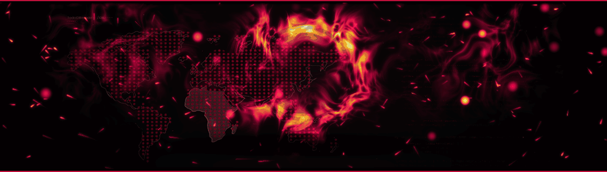
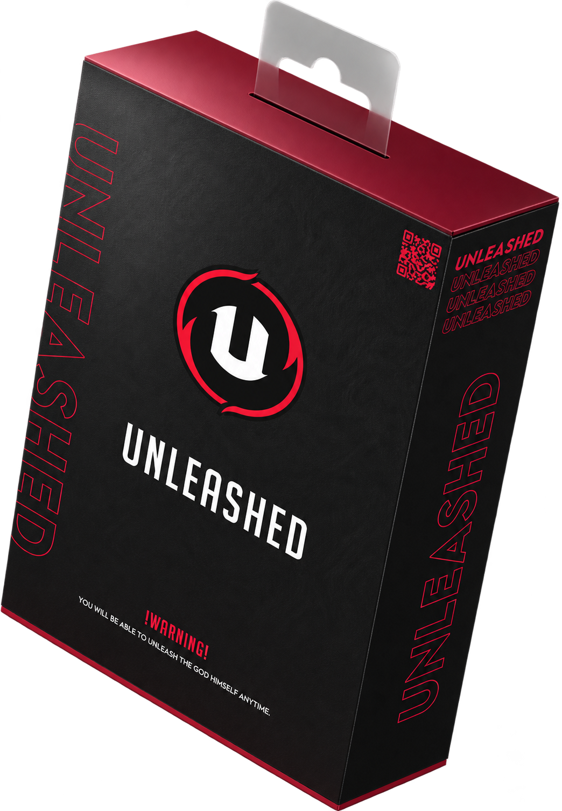
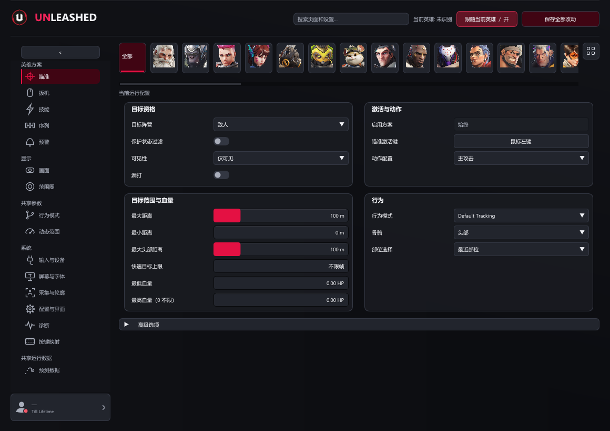
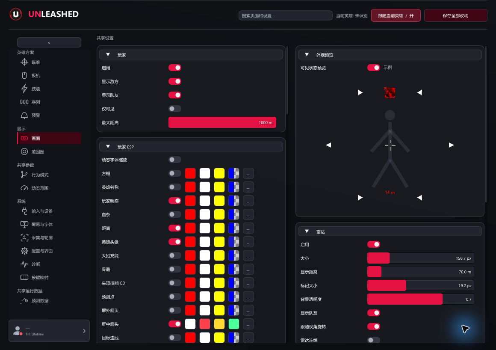
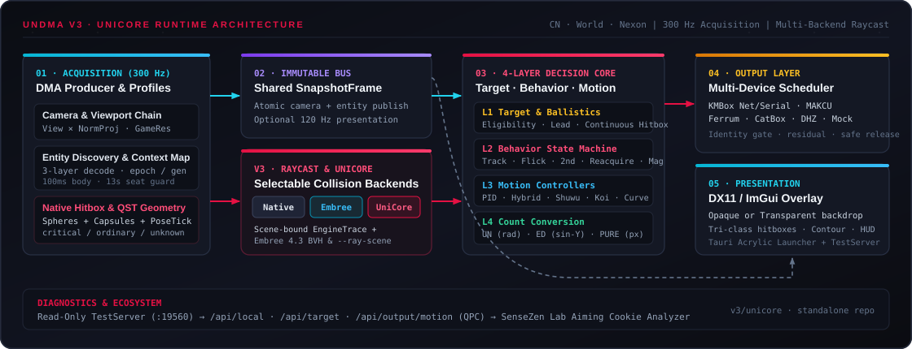

<div align="center">
  
  <h1>UNDMA V3 · UniCore</h1>
  <p><strong>Unleashed DMA V3 · Raycast, Multi-Backend Collision &amp; Modular Aim Research Runtime</strong></p>
  <p>Built on the verified V2 four-layer pipeline, adding Native / UniCore raycast backends, tri-class native hitboxes, and pluggable output models.</p>
  <p>
    <a href="./README.md">简体中文</a>
    ·
    <a href="../docs/un-dma-v3/V3_PROGRESS.zh-CN.md">Progress</a>
    ·
    <a href="../docs/un-dma-v3/RAYCAST_EVOLUTION.zh-CN.md">Raycast Evolution</a>
  </p>
  <p>
    
    
    
    
  </p>
</div>

<p align="center">
  
</p>

> A public-interest research runtime. V3 is an independently maintained repository (`v3/unicore`) with its own entry point, configuration, launcher, and validation evidence; V2 serves strictly as a read-only reference line.

Supports `2.25.1.0.155284` (`CN 155284N`, `Nexon 155284KB`, `World 155284`) native sphere/capsule geometry and tri-class hitbox classification.

## Preview

<p align="center">
  
</p>

<p align="center">
  
  
</p>

## Architecture

<p align="center">
  <a href="./assets/readme/v3-pipeline.svg"></a>
</p>

V3 keeps **acquisition**, **geometry intersection**, **four-layer aim decisions**, and **device output** cleanly decoupled:

- **300 Hz Acquisition &amp; Immutable Snapshots**: Entity discovery, composed view-projection matrices, 3-layer context-map decoding, and native hitbox shapes are published atomically into `SnapshotFrame`.
- **Multi-Backend Raycast &amp; Collision Service**:
  - `Native`: analytic sphere/capsule ray intersection with zero external dependencies;
  - `UniCore`: scene-bound `EngineTrace` + `UnicornBackend` research trace service, paired with `--ray-scene` offline playback and live-view return.
- **Tri-Class Native Hitboxes**: Reads shape-owned classification fields (`+0x28` sphere / `+0x38` capsule) into `critical`, `ordinary`, and `unknown` with independent wireframe and fill RGBA styling.
- **Overlay &amp; Launcher**: Runtime-toggleable opaque or transparent DX11 overlay canvas; Tauri v2 launcher with Win11 native Desktop Acrylic glass and Win10 borderless dark glass fallback.

## Four-Layer Algorithm &amp; Count Models

| Layer | Responsibility | V3 Capabilities |
| --- | --- | --- |
| **L1 Target &amp; Ballistics** | Who to target, where to aim, lead solving | Team/HP/distance/FOV gates, continuous trajectory-vs-hitbox intersection, continuity guards |
| **L2 Behavior** | When to engage, hold, fire, and cancel | `Tracking`, `Flick`, `Flick2nd`, `Reacquire`, `Magnetic Trigger` |
| **L3 Motion Method** | Turning error into controlled motion | `Linear`, `PID`, `Bezier`, `Piecewise`, `Accel`, `Constant`, `Hybrid PID`, `Shuwu`, `Response Curve`, `Koi` |
| **L4 Count &amp; Output** | Converting motion and driving hardware safely | `UN` radian / `ED` vertical `sin` / `PURE` pixel conversion; identity gates, residual tracking, safe release |

## Key Entry Points

```text
include/Game/V3Raycast.hpp              Native / UniCore unified raycast dispatcher
include/Game/EngineTrace.hpp            Scene-bound EngineTrace contract & UnicornBackend
include/Game/Target.hpp                 Target eligibility, hit windows & prediction
src/Features/aim/BehaviorController.cpp Aim behavior state machines & fire gating
src/Features/aim/Smoothing.cpp          Motion controllers & per-session smoothing state
src/Features/visuals/RayScene.cpp       Offline --ray-scene playback & live return
src/Renderer/                           DX11 + ImGui overlay (opaque & transparent canvas)
src/output/                             Device registry, capabilities, scheduler & telemetry
launcher/                               Tauri v2 Acrylic launcher & updater shell
```

## Run Locally

```powershell
# 1. Build native Release
./build-release.ps1

# 2. Build launcher + native runtime
./build-launcher.ps1

# 3. Start V3
./start-v3.ps1

# 4. Read-only config check & raycast selftests
./build/Release/UNDMA_V3.exe --config-check
./build-release.ps1 -Tests
ctest --test-dir build/selftests -C Release --output-on-failure
```

---

**SenseZen Research · UNDMA V3 (UniCore)**<br>
For extended multi-source algorithm experiments, see `un-dma-v3-algorithm-lab` (`v3/algorithm-lab`); for dual-PC trajectory &amp; assist telemetry analysis, see `lab/12_experiment-recorder`.
