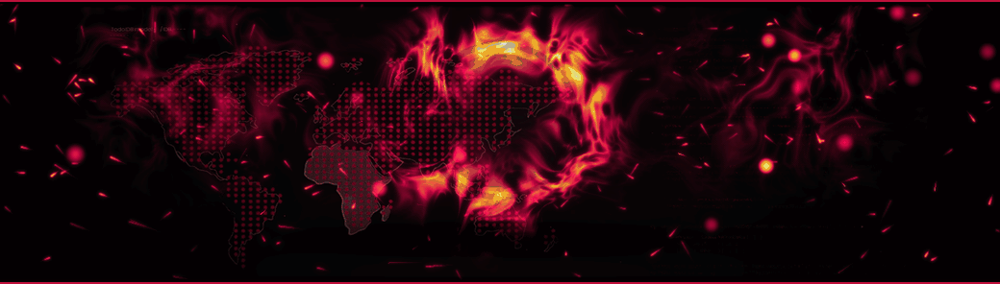
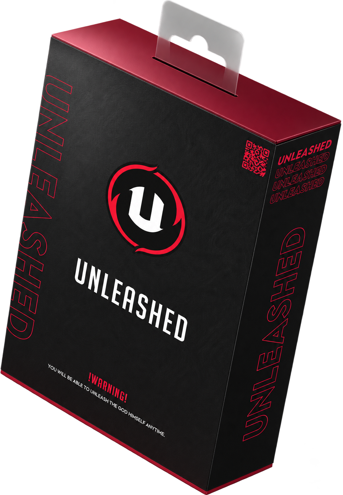
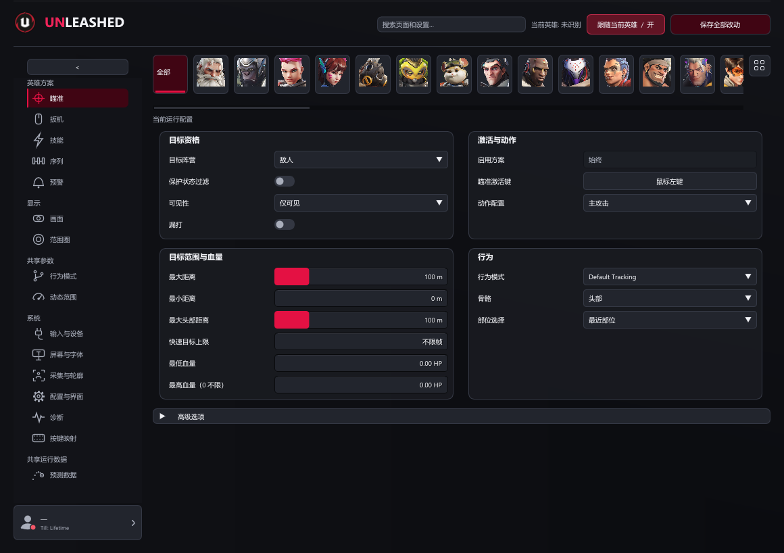
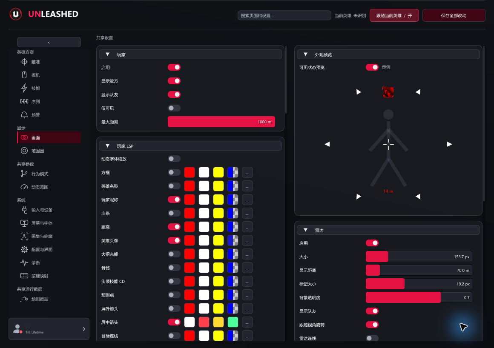
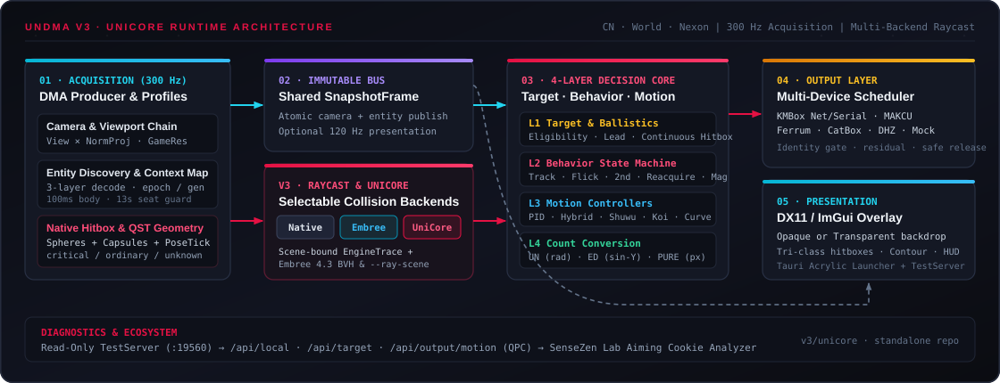

<div align="center">
  
  <h1>UNDMA V3 · UniCore</h1>
  <p><strong>Unleashed DMA V3 · Raycast, Multi-Backend Collision &amp; Modular Aim Research Runtime</strong></p>
  <p>在 V2 可验证四层管线基础上，引入 Native / Embree / UniCore 三后端射线检测、三服碰撞体分类着色与扩展输出模型。</p>
  <p>
    <a href="./README.en.md">English</a>
    ·
    <a href="../docs/un-dma-v3/V3_PROGRESS.zh-CN.md">研发进度</a>
    ·
    <a href="../docs/un-dma-v3/RAYCAST_EVOLUTION.zh-CN.md">射线迭代文档</a>
  </p>
  <p>
    
    
    
    
  </p>
</div>

<p align="center">
  
</p>

> 公益研究项目。V3 为独立演进仓库（`v3/unicore`），拥有独立入口、配置、构建、登录器与验证链路；V2 仅作为只读对照基线。

支持三服 `2.25.1.0.155284`（`CN 155284N`、`Nexon 155284KB`、`World 155284`）原生球体/胶囊碰撞体结构与分类着色。

## Preview

<p align="center">
  
</p>

<p align="center">
  
  
</p>

## Architecture

<p align="center">
  <a href="./assets/readme/v3-pipeline.svg"></a>
</p>

V3 将**数据生产**、**几何求交**、**四层瞄准决策**与**设备输出**保持清晰解耦：

- **300 Hz 采集与快照发布**：实体发现、相机合成矩阵、三层 Context Map 解码与原生 Hitbox 几何在同一提交代次发布到只读 `SnapshotFrame`，采集线程与渲染线程完全隔离。
- **三后端射线与碰撞体服务（V3 核心增量）**：
  - `Native`：解析几何球体/胶囊求交，零外部依赖；
  - `Embree`：随包部署 Intel Embree 4.3 BVH 局部对照；
  - `UniCore`：独立场景绑定的 `EngineTrace` + `UnicornBackend` 实验射线服务，并支持 `--ray-scene` 离线场景回放与设置页一键返回实时画面。
- **三服原生碰撞体分类**：读取球 `+0x28` / 胶囊 `+0x38` 原始字段，区分 `critical`、`ordinary`、`unknown` 三态，支持独立线框/填色 RGBA 自定义。
- **Overlay 与登录器**：支持不透明黑底或分层透明 Overlay 背景实时切换；Tauri 登录器适配 Win11 原生 Desktop Acrylic 磨砂玻璃与 Win10 无边框暗色玻璃。

## Four-Layer Algorithm & Count Models

| 层级 | 核心职责 | V3 能力 |
| --- | --- | --- |
| **L1 Target &amp; Ballistics** | 选谁、瞄哪里、算提前量 | 阵营/血量/距离/FOV 门控、连续弹道与原生体积相交、目标连续性守卫 |
| **L2 Behavior** | 何时启动、保持、开火、取消 | `Tracking`、`Flick`、`Flick2nd`、`Reacquire`、`Magnetic Trigger` |
| **L3 Motion Method** | 误差如何转为运动步长 | `Linear`、`PID`、`Bezier`、`Piecewise`、`Accel`、`Constant`、`Hybrid PID`、`Shuwu`、`Response Curve`、`Koi` |
| **L4 Count &amp; Output** | 运动如何换算并安全送达设备 | `UN` 弧度 / `ED` 竖直 `sin` / `PURE` 像素备用换算；身份门控、残差累计、全量释放 |

## Key Entry Points

```text
include/Game/V3Raycast.hpp              Native / Embree / UniCore unified raycast dispatcher
include/Game/EngineTrace.hpp            Scene-bound EngineTrace contract & UnicornBackend
include/Game/Target.hpp                 Target eligibility, hit windows & prediction
src/Features/aim/BehaviorController.cpp Aim behavior state machines & fire gating
src/Features/aim/Smoothing.cpp          Motion controllers & per-session smoothing state
src/Features/visuals/RayScene.cpp       Offline --ray-scene playback & live return
src/Renderer/                           DX11 + ImGui overlay (opaque & transparent canvas)
src/output/                             Device registry, capabilities, scheduler & telemetry
launcher/                               Tauri v2 Acrylic launcher & updater shell
```

## Run Locally

```powershell
# 1. 构建原生 Release（含 Embree 4.3 运行时同步）
./build-release.ps1

# 2. 构建登录器 + 原生程序
./build-launcher.ps1

# 3. 正常入口启动 V3
./start-v3.ps1

# 4. 只读配置检查 / 离线射线自测
./build/Release/UNDMA_V3.exe --config-check
./build-release.ps1 -Tests
ctest --test-dir build/selftests -C Release --output-on-failure
```

---

**SenseZen Research · UNDMA V3 (UniCore)**<br>
独立算法扩展实验线见 `un-dma-v3-algorithm-lab`（`v3/algorithm-lab`），双机轨迹与辅助对比分析见 `lab/12_experiment-recorder`。
